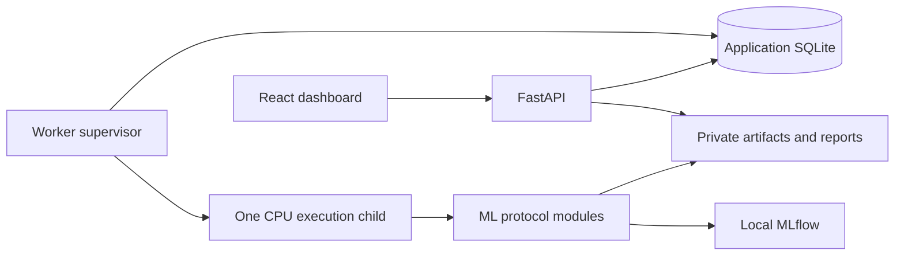

# ModelArena

**Fair comparisons. Reproducible experiments. Honest evaluation.**

  

ModelArena is a planned local ML experimentation platform for students and developers working with tabular data. It will bring scikit-learn models and a small PyTorch neural network into one workflow, making the reasoning behind a trustworthy experiment as visible as its results.

> **Day 6 verified locally:** Exact task metrics and Dummy classification/regression CV now run on frozen training folds with guarded fold-local preprocessing, timing and complete-fold mean/std. The dashboard, API server, durable worker/tracking, evaluation locks and full benchmark comparison remain planned.

## Why ModelArena

A high score is only useful when the evaluation is sound. Preprocessing before cross-validation, choosing models against test results, or skipping a simple baseline can make an experiment look better than it is.

ModelArena is designed to teach the full protocol: isolate data partitions, compare against baselines, interpret fold variability, record enough context to reproduce a run, and reserve the holdout for a final evaluation. It targets CPU laptops, with Windows as the initial verification platform, and requires no GPU, cloud service, or paid AI API.

## Planned capabilities

- **CSV to experiment:** Validate uploads, fingerprint datasets, select features and targets, and inspect training-only profiles with missingness and imbalance warnings.
- **Comparable models:** Run binary classification or regression candidates on shared cross-validation folds, including a Dummy baseline for each task.
- **Leakage prevention:** Fit imputation, scaling, and categorical encoding inside each training fold. Keep MLP early-stopping validation separate from outer CV validation and the holdout.
- **Transparent evaluation:** Rank candidates by a preselected CV metric, showing fold mean/std, baseline improvement, training time, and explicit reasons for undefined metrics.
- **PyTorch fundamentals:** Build a CPU MLP with Dataset/DataLoader, task-specific losses, Adam, early stopping, and per-fold training/validation loss curves.
- **Reproducible records:** Capture seeds, dataset fingerprints, split/fold identities, hyperparameters, package versions, metrics, and artifacts through local MLflow tracking and experiment manifests.
- **Reliable local execution:** Monitor one active training job in a separate process, with bounded resources, persistent job states, cancellation, and restart recovery.
- **Auditable results:** Freeze a selected model, refit on the training partition, evaluate the locked holdout once, and download an offline experiment report. Keep internally generated model artifacts in private storage.

### Models and diagnostics

| Task | Planned candidates | Planned metrics and diagnostics |
|---|---|---|
| Binary classification | DummyClassifier, LogisticRegression, RandomForestClassifier, HistGradientBoostingClassifier, PyTorch MLP | F1, precision, recall, ROC-AUC, average precision (AP), confusion matrix, ROC/PR curves |
| Regression | DummyRegressor, Ridge, RandomForestRegressor, HistGradientBoostingRegressor, PyTorch MLP | MAE, RMSE, R², residual and prediction diagnostics |

The baseline MLP uses two hidden layers (64 and 32 units) with ReLU, Adam, and BCEWithLogitsLoss for classification or MSELoss for regression. Detailed defaults, limits, and acceptance criteria are in the [project specification](docs/PROJECT_SPEC.md).

### Evaluation protocol

1. **Reserve the holdout.** Use a default 80/20 train/holdout split, stratified for binary classification, and keep analytical profiling on training data.
2. **Compare on training data.** Prefer five CV folds; use a documented feasible reduction down to two or reject unsuitable data. Every learned transformation stays within the appropriate fitting partition.
3. **Select by CV.** Compare complete candidates against the Dummy baseline using the chosen primary metric: F1 by default or AP for classification; RMSE by default or MAE for regression. Holdout results never determine leaderboard order.
4. **Evaluate the frozen selection.** Refit on the full training partition before one final holdout evaluation. For the MLP, derive the final epoch budget from CV rather than stopping against holdout results. Persist the evaluation audit trail and lock across restarts.

The intended learning outcomes are practical: recognize leakage, interpret baselines and fold variance, understand neural-network training, distinguish model randomness from split variability, and explain what a final test score can support.

## Planned architecture



FastAPI will validate requests and queue jobs; model training will run in a separate execution process. Application SQLite will own job state and holdout locks, while MLflow will use its own local SQLite store for experiment tracking. The dashboard will poll persisted progress and results.

Uploads, databases, models, and reports will live in private local storage outside the checkout by default and remain excluded from Git. The design will reject untrusted serialized model imports and include explicit data deletion controls.

## Planned technology stack

| Layer | Technologies |
|---|---|
| Dashboard | React, TypeScript, Vite, Tailwind CSS, shadcn/ui, Recharts |
| API and validation | FastAPI, Pydantic |
| Data and classical ML | pandas, NumPy, scikit-learn |
| Neural networks | PyTorch CPU |
| State and tracking | SQLite, local MLflow |
| Verification | pytest, httpx, Playwright browser checks |
| Dependency management | uv with a Python lockfile; npm with a frontend lockfile |

The Windows Python environment and CPU-only torch wheel have passed the Day 1 smoke check. See [validation evidence](docs/VALIDATION.md) for versions and limits of that verification. Frontend dependency locking is scheduled for Day 22.

## Development roadmap

Verified delivery as of **2026-10-26**:

| Work package | Delivery state | Verification / commit evidence |
|---|---|---|
| Day 1 environment, settings and inventory | Committed | 59 tests passed, zero skips; `2dc1dc7`, `f989c16`, `de54447`; see [validation evidence](docs/VALIDATION.md#day-1-commit-verification--2026-10-23) |
| Day 2 CSV parsing and initial resource probe | Committed | 103 tests passed, zero skips; `6270779`, `44be1cb`; actual four-thread probe and staged commit verification recorded in [validation evidence](docs/VALIDATION.md#day-2--2026-10-23) |
| Day 3 task validation and training profiles | Committed | 150 tests passed, zero skips; `d58159f`; see [validation evidence](docs/VALIDATION.md#day-3--2026-10-26) |
| Day 4 immutable splits and fold feasibility | Committed | 205 tests passed, zero skips; `64a8804`; see [validation evidence](docs/VALIDATION.md#day-4--2026-10-26) |
| Day 5 fold-local preprocessing and memory guards | Committed | 226 tests passed, zero skips; see [validation evidence](docs/VALIDATION.md#day-5--2026-10-26) |
| Day 6 exact metrics and Dummy CV | Verified; delivery on `feat/day-6-metrics-baseline-cv` | 277 tests passed, zero skips; see [validation evidence](docs/VALIDATION.md#day-6--2026-10-26) |
| G1 — Data correctness | In progress; gate not passed | Days 1–6 complete; Day 7 pending |
| G2 — Classical experiments | Not started | Acceptance pending |
| G3 — MLP and resource evidence | Not started | Acceptance pending |
| G4 — Usable local release | Not started | Acceptance pending |

Six daily work packages are complete; **0/4 milestone gates have passed**. Current tests cover setup, parsing, task validation, training-only profiles, frozen partitions, fold-local preprocessing, allocation guards, exact task metrics, Dummy CV and initial instrumentation; the full candidate suite, worker resource enforcement, tracking and application usability require later acceptance checks.

The target is **28 focused workdays, approximately 75 hours**, including five hours of contingency and release verification. These are work sessions, not a commitment to 28 consecutive calendar days. Training and benchmark runtime is tracked separately; the schedule may extend to meet correctness and reliability gates.

| Phase | Target sessions | Planned milestone |
|---|---|---|
| 1. Data correctness | Days 1–7 | Locked environment, CSV validation, training profiles, immutable splits, fold-local preprocessing, Dummy CV, and durable queue tests |
| 2. Reliable classical experiments | Days 8–14 | Windows worker lifecycle and recovery, classical model suites, metrics, MLflow, CV leaderboard/API, and holdout reservation tests |
| 3. PyTorch and final evaluation | Days 15–21 | Both MLP tasks, inner-fold early stopping, loss curves, full-training refit, guarded holdout evaluation, reproducibility checks, and CPU profiling |
| 4. Complete local workflow | Days 22–28 | Dashboard, downloadable reports, deletion controls, two-task demonstrations, end-to-end tests, and verified setup documentation |

Release criteria include automated leakage, split, metric, invalid-input, and worker-lifecycle tests, plus deterministic reruns within documented tolerance. Both demonstration datasets must beat their Dummy baseline on the selected CV metric; no results are claimed yet.

**Later scope:** P1 covers bounded nested tuning (up to 12 configurations per model), validation-based permutation importance, trusted model packaging, restricted import/standalone inference, and Bank Marketing integration. P2 covers optional explanations of observed metrics using rules or a local language model. These have no allocation in the core schedule.

The MVP covers independent tabular observations for binary classification and regression. Multiclass, grouped/temporal evaluation, multi-user operation, distributed training, cloud deployment, live inference hosting, and autonomous LLM agents are outside its scope.

## Planned examples and resource limits

- **Breast Cancer Wisconsin Diagnostic:** Binary classification using scikit-learn's packaged dataset.
- **California Housing:** Regression using an explicitly prepared local cache; the first use may require an opt-in download. Training jobs will not download data.
- **UCI Bank Marketing:** Later mixed-type and imbalance example; pre-call prediction must exclude `duration`, which is known only after the call.

The design targets CPU laptops with roughly 8–16 GB RAM, one active job, and bounded threads, memory, epochs, and runtime. Initial upload limits are 20 MB (20,000,000 bytes) and 50,000 rows; final resource settings depend on measurement.

## Installation and usage

Day 1 developer setup was verified on Windows PowerShell with Python 3.12.15, uv 0.13.5, Node 24.19.0, and npm 12.2.0. Install uv using its [official instructions](https://docs.astral.sh/uv/getting-started/installation/). If it is installed outside PATH, use `& "$env:USERPROFILE/.local/bin/uv.exe"` in place of `uv` in the commands below. Shell activation is unnecessary.

```powershell
uv python install 3.12.15
uv sync --locked
uv run --locked python -c "import fastapi, sklearn, torch, mlflow; print(torch.__version__); assert torch.version.cuda is None"
uv run --locked pytest -q
uv run --locked python -m scripts.profile_hardware
npm.cmd ci --ignore-scripts
```

The root npm manifest locks the toolchain only; no frontend exists yet. `npm --prefix apps/web ci` becomes applicable on Day 22. Python dependencies use exact direct pins and the transitive `uv.lock`; torch comes from the explicit [CPU wheel index](https://docs.astral.sh/uv/guides/integration/pytorch/).

Settings default to `%LOCALAPPDATA%/ModelArena` on Windows and `$XDG_DATA_HOME/modelarena` or `~/.local/share/modelarena` elsewhere. `MODELARENA_HOME` may override this with an absolute directory on a local, unsynchronized disk. Network shares and common synchronized-folder paths are rejected; the operator must also avoid other sync tools. Settings imports create no files. The inventory command writes `inventory/hardware.json` under application home, outside the checkout by default, with observed available RAM, power scheme, package versions, and lock checksums. `MODELARENA_COMPUTE_THREADS` accepts 2, 4, or 6; the default is 4. The 4 GiB child RSS cap and other policy-v1 settings are configuration contracts; worker enforcement and performance validation arrive in later tasks.

Read the [project specification](docs/PROJECT_SPEC.md) for detailed requirements, evaluation rules, and the definition of done.

### Initial resource probe

```powershell
uv run --locked python -m scripts.benchmark --stage initial --threads 4
```

Run this command as a fresh process. It uses the bundled Breast Cancer dataset, reserves 20% without scoring it, parses only the remaining 455 rows, and runs serial five-fold Dummy CV. The report records seeds, row-identity hashes, parser hashes, actual thread pools, package/lock identity, and sampled process RSS/CPU/system free memory. Generated JSON stays under application home in `benchmarks/`; scratch CSV files are removed. The command refuses a second initial probe while its lock exists. After an interrupted process, verify it has exited before manually removing a stale `initial.lock`.

Parser policy v1 accepts UTF-8/BOM comma CSV and preserves string values, including empty cells, whitespace, and numeric spellings. It rejects malformed records, duplicate/blank headers, unsafe paths, and exceeded byte/row/column/cell/memory bounds. The canonical SHA-256 includes ordered headers and records while ignoring BOM, equivalent quoting, and line-ending style.

Day 3 adds `configure_dataset(parsed, config)` with frozen `DatasetConfig` and ordered `FeatureSchema` declarations. Binary classification requires an explicit positive label, mapped to 1; the other label maps to 0. Regression requires finite, variable numeric targets. Selected features declare numeric, categorical or boolean types; no full-data type inference occurs. Empty/whitespace-only cells are missing, other categorical spellings remain literal, and nonfinite numeric inputs are rejected. Boolean features accept true/false or 1/0, case insensitive.

Repeated selected, typed features require explicit acknowledgement, including complete repeats and differing labels. No rows are removed. Numeric spellings such as `1` and `1.0` compare equally for this gate. Detailed duplicate counts are exposed only through `profile_training(view)`, together with training dimensions, missingness, population standard deviation, linear quartiles, target distribution and heuristic warnings. Category top counts are capped at five per feature and warnings at twenty, with a truncation flag. Review ID-like and post-outcome features before experiments; Bank pre-call prediction requires excluding `duration`.

Day 4 adds `create_split(parsed, config, RunConfig())`, canonical JSON persistence with `write_manifest`/`read_manifest`, and `training_from_manifest(configured, manifest)`. The latter verifies source/configuration identity and checksum before copying persisted training rows for profiling. The default holdout is 20%, rounded up with a two-row minimum; outer CV prefers five folds and adapts only when all inner MLP partitions remain feasible. Binary splits require both labels throughout; regression validation sets require at least two rows. Conflicting writes cannot replace a frozen manifest. See the [experiment protocol](docs/EXPERIMENT_PROTOCOL.md) for seeds, hashes, feasibility and storage behavior.

The lower-level `training_view(configured, row_ids)` remains a trusted internal helper. Do not expose it to arbitrary client indices or use profile statistics to fit preprocessing. Persisted files do not yet provide the durable evaluation-scope lock, which remains later work. Grouped/temporal evaluation remains unsupported, and duplicate acknowledgement does not establish row independence.

This small probe does not select a final resource policy. Four compute threads and a 4 GiB RSS cap remain provisional. Worker termination, API responsiveness, and the full 2/4/6-thread comparison remain later acceptance tasks.
