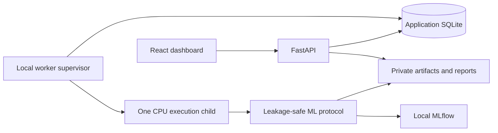

# ModelArena

**A planned local-first platform for learning how to run, compare and evaluate machine learning experiments correctly.**

ModelArena is designed for students and developers working with tabular datasets on a Windows CPU laptop. It will bring classical scikit-learn models and a small PyTorch neural network into one reproducible workflow, with explicit training/validation boundaries, baseline comparisons and a locked final holdout evaluation.

> **Project status: planning only.** Architecture decisions have conditional approval with revisions. Implementation has not been authorized. No application has been scaffolded, dependencies installed, models trained, or functionality implemented and tested. The capabilities below are planned requirements, not working features.

## Why ModelArena

Running several algorithms is easier than comparing them fairly. Preprocessing fitted before cross-validation, early stopping on evaluation data, repeated test-set peeking and missing experiment metadata can all produce misleading results.

ModelArena aims to make those mistakes harder to make and easier to understand. Its educational focus is the experiment protocol: what each partition is for, how a baseline changes interpretation, what fold variance means, and why a final test result must remain separate from model selection.

## Planned workflow

1. Upload a CSV or prepare a local example dataset.
2. Select the target, task, features, positive label where applicable, and primary evaluation metric.
3. Inspect a training-only data profile and acknowledge relevant data-quality warnings.
4. Run bounded, leakage-safe cross-validation in a separate local worker process.
5. Compare complete candidates against a Dummy baseline using CV mean and standard deviation.
6. Inspect task diagnostics and per-fold MLP training/validation loss curves.
7. Freeze a selected model, refit on the complete training partition, and evaluate the locked holdout once.
8. Download a local experiment report containing metrics, provenance, limitations and an evaluation audit trail.

None of these steps is currently available in an application.

## Planned mandatory features — P0

| Area | Required planned behavior |
|---|---|
| Data ingestion | CSV validation, dataset fingerprints, task/target/feature selection and clear invalid-input errors. |
| Profiling | Training-only dimensions, dtypes, missingness, feature statistics and target distribution/imbalance. |
| Split protocol | Default 80/20 holdout; five CV folds when feasible, adapting explicitly down to two; persisted row/fold identities. |
| Preprocessing | Fold-local numeric imputation/scaling and categorical imputation/one-hot encoding with unknown-category handling. |
| Binary classification | DummyClassifier, LogisticRegression, RandomForestClassifier, HistGradientBoostingClassifier and a PyTorch CPU MLP. |
| Regression | DummyRegressor, Ridge, RandomForestRegressor, HistGradientBoostingRegressor and a PyTorch CPU MLP. |
| MLP fundamentals | Baseline hidden layers 64/32 with ReLU, Adam, batch size 32, maximum 100 epochs and patience 10; inner-fold early stopping and saved loss curves. |
| Evaluation | Classification F1/precision/recall/ROC-AUC/average precision and confusion matrices; regression MAE/RMSE/R² and residual diagnostics; explicit undefined metrics. |
| Comparison | Frozen primary CV metric, fold mean/std, baseline improvement and training duration; no holdout-based ranking. |
| Reproducibility | Seeds, split/fold hashes, model parameters, package versions, dataset identity, manifests and local MLflow records. |
| Execution | Separate worker, one active training job, bounded resources, durable queue/progress, cancellation and interruption/restart handling. |
| Final evaluation | Immutable selected model/configuration/split, full-training refit, persistent holdout lock and an auditable final result. |
| Reports and artifacts | Downloadable offline experiment reports and internally stored trusted model artifacts with metadata/checksums. |
| Correctness | Leakage, splitting, invalid-data, metrics, process lifecycle, API and browser workflow tests. |

Repeated feature values can represent legitimate independent observations. The planned validator will distinguish complete-row and feature-only duplicates, warn about potential leakage and require explicit risk acknowledgement rather than blanket rejection. Random splitting assumes independent observations; grouped and temporal evaluation are outside P0.

For final MLP refitting, the training budget will come from the median best CV epoch, followed by fresh preprocessing and model fitting on the whole training partition. A verified failure before holdout evaluation starts may retry that same frozen selection. Once evaluation starts, recovery will fail closed rather than automatically evaluate the holdout again.

## Optional scope — P1 / P2

These features have no allocation in the mandatory 28-day plan and may be deferred.

- **P1:** nested randomized tuning capped at 12 configurations per model, validation-only permutation importance, downloadable versioned trusted model packages, restricted model import/standalone inference, and Bank Marketing integration.
- **P2:** optional explanations of observed metrics using rules or an installed local language model. No paid API or external model provider is required.

Multiclass classification, time series, multi-user operation, distributed training, cloud deployment, live inference hosting and autonomous LLM agents are outside the MVP.

## Planned technology stack

| Layer | Technology |
|---|---|
| Dashboard | React, TypeScript, Vite, Tailwind CSS, shadcn/ui, Recharts |
| Local API | FastAPI, Pydantic |
| Data and classical ML | pandas, NumPy, scikit-learn |
| Neural networks | PyTorch CPU |
| Experiment tracking | MLflow with local SQLite metadata and local artifacts |
| Application state | Separate SQLite database for datasets, jobs, results and evaluation locks |
| Execution | Python process supervisor and one spawned execution child |
| Verification | pytest, httpx; planned Playwright browser checks |
| Dependencies | uv with a committed Python lockfile; npm lockfile for the frontend |

Exact versions and Windows CPU-wheel compatibility have not been verified. Dependency selection and installation are future implementation tasks.

## Architecture overview



The API will validate and queue jobs; training will run outside its request process. CV modules will receive training data only. A separately gated finalization path will access the holdout after selection is frozen and evaluation-start is durably recorded.

Application SQLite will own job state and evaluation locks. MLflow will record experiment configurations, metrics and artifacts. Both will operate locally; a separate tracking server will not be required. Plain functions, typed data classes and small modules are preferred over additional infrastructure or generic orchestration frameworks.

Uploads, train/holdout copies, model files and generated reports will live in private application storage outside the checkout and publicly served directories. Completed experiments will be retained until explicitly deleted. Before deletion, the UI will explain the minimal keyed evaluation fingerprint/lock retained to prevent accidental holdout reuse. Confirmed deletion must remove raw/derived dataset copies and related artifacts and detailed metadata; an incomplete cleanup must remain visibly pending.

The public [project specification](docs/PROJECT_SPEC.md) defines the product requirements and acceptance criteria.

## Development roadmap

The target is **28 focused workdays, approximately 75 hours**, including five hours of protected contingency. Reference hardware is confirmed as an AMD Ryzen 5 5500U (6 cores / 12 logical processors), 15.33 GiB RAM and Windows 11. Available daily development hours remain unconfirmed. Resource limits are provisional: hardware profiling and a 2/4/6-thread comparison will precede final settings. No benchmarks have run. The timeline may extend to preserve mandatory correctness and reliability requirements.

| Milestone | Target | Planned exit criteria |
|---|---|---|
| G1 — Data correctness | Days 1–7 | Environment/hardware check, bounded CSV validation, profiles, immutable splits, safe preprocessing/Dummy CV and durable queue tests. |
| G2 — Reliable classical experiments | Days 8–14 | Windows worker lifecycle, cancellation/recovery, classical model suites, MLflow, CV ranking/API and holdout reservation tests. |
| G3 — PyTorch and evaluation | Days 15–21 | Both MLP tasks, strict inner early stopping, curves, full-training refit, finalization recovery, deterministic reruns and resource profiling. |
| G4 — Usable local workflow | Days 22–28 | Dashboard, reports, deletion, two-task demonstrations, full verification and setup documentation; final two days reserved for P0 remediation/release checks. |

Machine learning correctness, reproducibility and educational clarity take priority over frontend polish. P1/P2 features will be deferred first if needed; no mandatory P0 requirement will be removed without approval.

## Example datasets and resource assumptions

- **Breast Cancer Wisconsin Diagnostic:** planned binary-classification demonstration using scikit-learn's packaged dataset.
- **California Housing:** planned regression demonstration; a one-time explicitly authorized download/cache step is required when unavailable locally. Training will never download data automatically.
- **UCI Bank Marketing:** stretch integration dataset; pre-call prediction must exclude `duration`, which is known only after the call.

The planned target is a CPU-only laptop with approximately 8–16 GB RAM, one active training job and bounded threads/epochs/time/memory. Initial CSV limits are 20 MB (20,000,000 bytes) and 50,000 rows, with conservative encoding bounds. The approximately five-minute Breast Cancer classical-run target is an unverified benchmark goal, not a performance claim. No GPU, cloud subscription or paid model API is needed by the design.

## Repository structure

Public repository files:

```text
ModelArena/
├── AGENTS.md
├── README.md
├── .gitignore
└── docs/
    └── PROJECT_SPEC.md
```

Planned application layout — **these source directories have not been created**:

```text
apps/
  api/                 # API, SQLite repositories, services and process worker
  web/src/             # React workflow, comparison and chart components
ml/
  data/                # Validation, training profiles and persisted splits
  preprocessing/       # Fold-local transformations and allocation guards
  models/              # Classical estimators and PyTorch network
  training/            # CV, inner early stopping and final full-train refit
  evaluation/          # Metrics and gated holdout evaluation
  tracking/            # MLflow integration and reproducibility manifests
tests/
  unit/
  integration/
  e2e/
  fixtures/
experiments/configs/   # Safe demo configurations, without user data
scripts/               # Hardware profiling, benchmarks and example preparation
docs/                  # Protocol, validation evidence and model limitations
```

Runtime data, models, MLflow stores and reports will be excluded from Git and kept outside the source tree by default.

## Installation and usage

There is no runnable application yet. This checkout contains documentation only; there are no dependency manifests, startup commands or implemented training workflows. Application installation and usage instructions will be added after implementation and verification on Windows. For now, read the [project specification](docs/PROJECT_SPEC.md) for the intended behavior and acceptance criteria.

## Current status and next gate

| Item | Status |
|---|---|
| Product specification | Available in [PROJECT_SPEC.md](docs/PROJECT_SPEC.md) |
| Architecture decisions | Conditionally approved; requested revisions incorporated into planning documentation |
| Daily implementation plan | Drafted for review; execution not authorized |
| Application code and dependency setup | Not started |
| Working or tested application features | None |
| Training, benchmark or performance results | None |
| Installation and run instructions | Will be added after implementation and Windows verification |

The next step is explicit approval of implementation. Architecture approval does not authorize installation, scaffolding or training. This README intentionally provides no unverified setup commands or claims of successful experiments.
