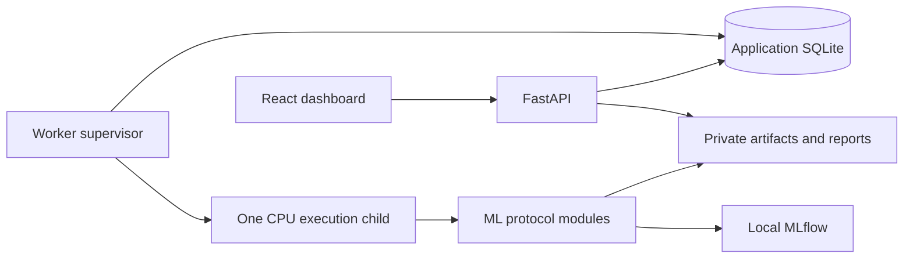

# ModelArena

**Fair comparisons. Reproducible experiments. Honest evaluation.**

  

ModelArena is a planned local ML experimentation platform for students and developers working with tabular data. It will bring scikit-learn models and a small PyTorch neural network into one workflow, making the reasoning behind a trustworthy experiment as visible as its results.

> **Planning stage:** This repository currently contains documentation only. Application code, tests, training workflows, and benchmarks have not been implemented or run. All capabilities below are planned.

## Why ModelArena

A high score is only useful when the evaluation is sound. Preprocessing before cross-validation, choosing models against test results, or skipping a simple baseline can make an experiment look better than it is.

ModelArena is designed to teach the full protocol: isolate data partitions, compare against baselines, interpret fold variability, record enough context to reproduce a run, and reserve the holdout for a final evaluation. It targets CPU laptops, with Windows as the initial verification platform, and requires no GPU, cloud service, or paid AI API.

## Planned capabilities

- **CSV to experiment:** Validate uploads, fingerprint datasets, select features and targets, and inspect training-only profiles with missingness and imbalance warnings.
- **Comparable models:** Run binary classification or regression candidates on shared cross-validation folds, including a Dummy baseline for each task.
- **Leakage prevention:** Fit imputation, scaling, and categorical encoding inside each training fold. Keep MLP early-stopping validation separate from outer CV validation and the holdout.
- **Transparent evaluation:** Rank candidates by a preselected CV metric, showing fold mean/std, baseline improvement, training time, and explicit reasons for undefined metrics.
- **PyTorch fundamentals:** Build a CPU MLP with Dataset/DataLoader, task-specific losses, Adam, early stopping, and per-fold training/validation loss curves.
- **Reproducible records:** Capture seeds, dataset fingerprints, split/fold identities, hyperparameters, package versions, metrics, and artifacts through local MLflow tracking and experiment manifests.
- **Reliable local execution:** Monitor one active training job in a separate process, with bounded resources, persistent job states, cancellation, and restart recovery.
- **Auditable results:** Freeze a selected model, refit on the training partition, evaluate the locked holdout once, and download an offline experiment report. Keep internally generated model artifacts in private storage.

### Models and diagnostics

| Task | Planned candidates | Planned metrics and diagnostics |
|---|---|---|
| Binary classification | DummyClassifier, LogisticRegression, RandomForestClassifier, HistGradientBoostingClassifier, PyTorch MLP | F1, precision, recall, ROC-AUC, average precision (AP), confusion matrix, ROC/PR curves |
| Regression | DummyRegressor, Ridge, RandomForestRegressor, HistGradientBoostingRegressor, PyTorch MLP | MAE, RMSE, R², residual and prediction diagnostics |

The baseline MLP uses two hidden layers (64 and 32 units) with ReLU, Adam, and BCEWithLogitsLoss for classification or MSELoss for regression. Detailed defaults, limits, and acceptance criteria are in the [project specification](docs/PROJECT_SPEC.md).

### Evaluation protocol

1. **Reserve the holdout.** Use a default 80/20 train/holdout split, stratified for binary classification, and keep analytical profiling on training data.
2. **Compare on training data.** Prefer five CV folds; use a documented feasible reduction down to two or reject unsuitable data. Every learned transformation stays within the appropriate fitting partition.
3. **Select by CV.** Compare complete candidates against the Dummy baseline using the chosen primary metric: F1 by default or AP for classification; RMSE by default or MAE for regression. Holdout results never determine leaderboard order.
4. **Evaluate the frozen selection.** Refit on the full training partition before one final holdout evaluation. For the MLP, derive the final epoch budget from CV rather than stopping against holdout results. Persist the evaluation audit trail and lock across restarts.

The intended learning outcomes are practical: recognize leakage, interpret baselines and fold variance, understand neural-network training, distinguish model randomness from split variability, and explain what a final test score can support.

## Planned architecture

FastAPI will validate requests and queue jobs; model training will run in a separate execution process. Application SQLite will own job state and holdout locks, while MLflow will use its own local SQLite store for experiment tracking. The dashboard will poll persisted progress and results.

Uploads, databases, models, and reports will live in private local storage outside the checkout by default and remain excluded from Git. The design will reject untrusted serialized model imports and include explicit data deletion controls.

## Planned technology stack

| Layer | Technologies |
|---|---|
| Dashboard | React, TypeScript, Vite, Tailwind CSS, shadcn/ui, Recharts |
| API and validation | FastAPI, Pydantic |
| Data and classical ML | pandas, NumPy, scikit-learn |
| Neural networks | PyTorch CPU |
| State and tracking | SQLite, local MLflow |
| Verification | pytest, httpx, Playwright browser checks |
| Dependency management | uv with a Python lockfile; npm with a frontend lockfile |

Versions and CPU-wheel compatibility will be verified during setup.

## Development roadmap

The target is **28 focused workdays, approximately 75 hours**, including five hours of contingency and release verification. These are work sessions, not a commitment to 28 consecutive calendar days. Training and benchmark runtime is tracked separately; the schedule may extend to meet correctness and reliability gates.

| Phase | Target sessions | Planned milestone |
|---|---|---|
| 1. Data correctness | Days 1–7 | Locked environment, CSV validation, training profiles, immutable splits, fold-local preprocessing, Dummy CV, and durable queue tests |
| 2. Reliable classical experiments | Days 8–14 | Windows worker lifecycle and recovery, classical model suites, metrics, MLflow, CV leaderboard/API, and holdout reservation tests |
| 3. PyTorch and final evaluation | Days 15–21 | Both MLP tasks, inner-fold early stopping, loss curves, full-training refit, guarded holdout evaluation, reproducibility checks, and CPU profiling |
| 4. Complete local workflow | Days 22–28 | Dashboard, downloadable reports, deletion controls, two-task demonstrations, end-to-end tests, and verified setup documentation |

Release criteria include automated leakage, split, metric, invalid-input, and worker-lifecycle tests, plus deterministic reruns within documented tolerance. Both demonstration datasets must beat their Dummy baseline on the selected CV metric; no results are claimed yet.

**Later scope:** P1 covers bounded nested tuning (up to 12 configurations per model), validation-based permutation importance, trusted model packaging, restricted import/standalone inference, and Bank Marketing integration. P2 covers optional explanations of observed metrics using rules or a local language model. These have no allocation in the core schedule.

The MVP covers independent tabular observations for binary classification and regression. Multiclass, grouped/temporal evaluation, multi-user operation, distributed training, cloud deployment, live inference hosting, and autonomous LLM agents are outside its scope.

## Planned examples and resource limits

- **Breast Cancer Wisconsin Diagnostic:** Binary classification using scikit-learn's packaged dataset.
- **California Housing:** Regression using an explicitly prepared local cache; the first use may require an opt-in download. Training jobs will not download data.
- **UCI Bank Marketing:** Later mixed-type and imbalance example; pre-call prediction must exclude `duration`, which is known only after the call.

The design targets CPU laptops with roughly 8–16 GB RAM, one active job, and bounded threads, memory, epochs, and runtime. Initial upload limits are 20 MB (20,000,000 bytes) and 50,000 rows; final resource settings depend on measurement.

## Installation and usage

There is no runnable application or dependency manifest to install yet. Setup and usage commands will be added after implementation and verification on Windows.

Read the [project specification](docs/PROJECT_SPEC.md) for detailed requirements, evaluation rules, and the definition of done.
